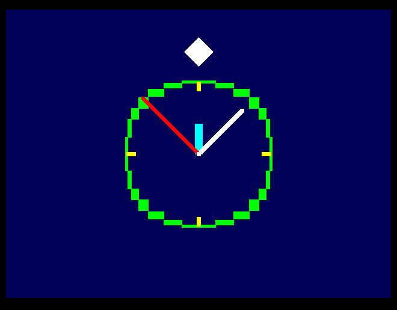
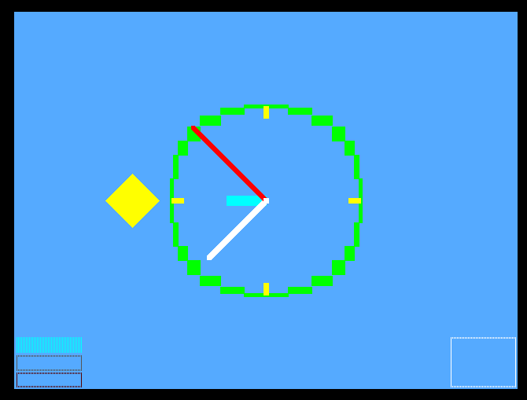
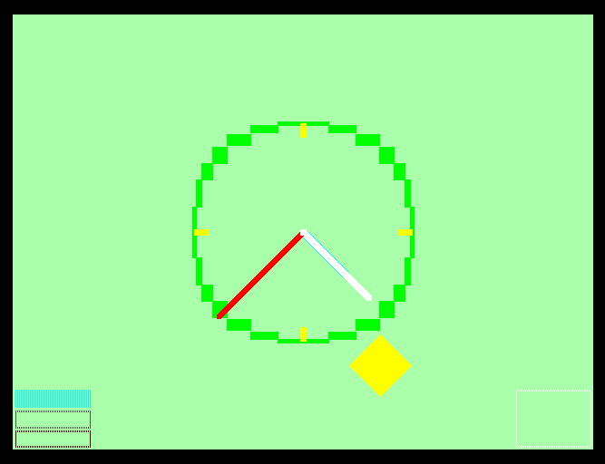
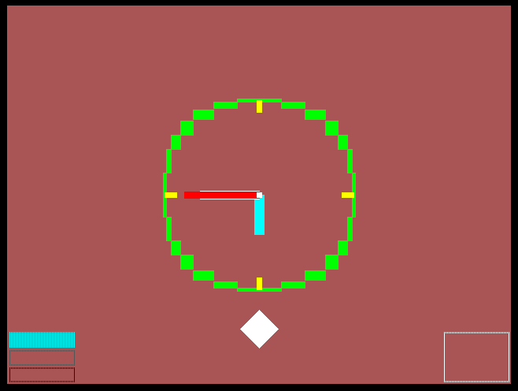
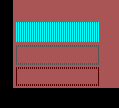
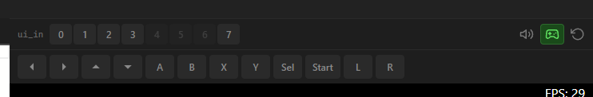
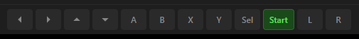
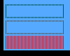
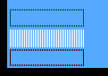
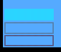

# How it works

This project is inspired by an [analog clock for the console](https://kmandla.wordpress.com/2009/12/26/an-analog-clock-for-the-console/) from Linux.

A VGA clock display implemented in Verilog for the Tiny Tapeout demoscene competition.

The design renders a circular analog clock face at 640×480 resolution. The background color changes based on the current hour:

| Period  | Time Range    | Background Color |
| ------- | ------------- | ---------------- |
| Night   | 00:00 ~ 05:59 | Dark navy        |
| Morning | 06:00 ~ 11:59 | Bright sky blue  |
| Daytime | 12:00 ~ 17:59 | Light sky blue   |
| Evening | 18:00 ~ 23:59 | Sunset orange    |

A sun appears during morning and daytime, and a moon appears during evening and night. Both move across the sky in an arc according to the current hour. The clock face has hour and minute markers, and three hands for hours, minutes, and seconds.

Night

Morning

Daytime

Evening

From top to bottom, the indicators show hour, minute, and second adjustment mode.

The box on the lower right lets the user know that the clock is in setup mode.

This is the sun.

This is the moon.

# How to test

Connect a VGA monitor to the output pins. Power on the design, and the clock will start running from 00:00:00.

To adjust the time, connect a Gamepad PMOD to the input pins. Press Start to enter time adjustment mode. Use Up/Down to increment or decrement the selected field. Press Select to cycle between hour, minute, and second adjustment. Press Start again to exit adjustment mode.

If you are using the Tiny Tapeout VGA Playground, use the PMOD key controls to set the time.

Press and release the Start button to enter clock setup mode.

You can toggle between hour, minute, and second adjustment using the Sel button.

By default, setup mode adjusts the seconds.

This is minute adjustment mode.

Lastly, this is hour adjustment mode.

Here is the link to test it out:

[VGA Playground](https://vga-playground.com/?repo=https%3A%2F%2Fgithub.com%2Felectron65%2Fttsky-electron65&ref=dd5cec8e141130985bbc8143fcac65022de57dd9)

# External hardware

* VGA monitor
* Gamepad PMOD

# External links

* [Clockywock concept](https://kmandla.wordpress.com/2009/12/26/an-analog-clock-for-the-console/)
* [Website](https://www.kojw.com)
* [LinkedIn](https://www.linkedin.com/in/jong-wan-ko-673149256)
